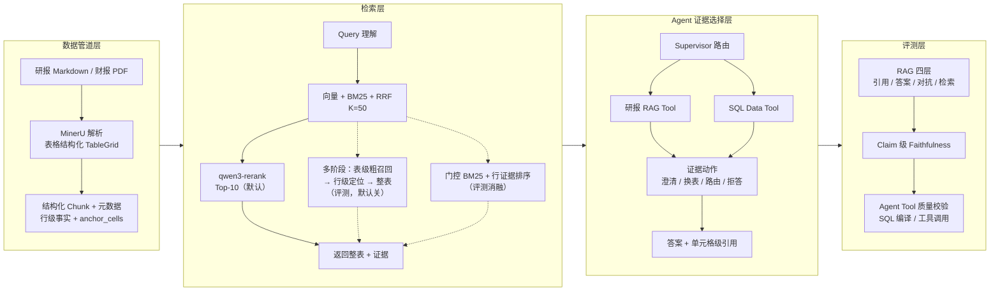

# 复杂表格Agentic RAG：解析→检索→Agent证据选择→Faithfulness评测

> **30 秒速览**
> - **业务场景**：财务研报与财报的复杂表格 RAG，核心解决“表格被切碎”与“证据无法溯源到单元格”的痛点。
> - **硬核指标**：引用文件可溯源 100%；召回层（K=50）数字级命中 70.6%→74.9%；20道可评题题均 Claim 支持率 99.38%（95% CI 98.13–100）。
> - **三条主边界**：① Faithfulness ≠ 答案准确率；② 22题评测集非真实用户分布；③ 门控 BM25 与多阶段检索是评测能力，线上默认关闭。

表格在 RAG 中常被切碎、证据无法定位到单元格。本项目以结构保留解析、行级事实、多阶段召回、Agent 证据选择与 Claim 级 Faithfulness 构成闭环；财务是验证场景，方法可迁移到其他复杂表格语料。

**技术栈**：RAG · Agent · LangGraph · Qdrant · BM25+RRF · FastAPI · pytest 1010

[](https://github.com/autumnieave/smart-financial-qa/actions/workflows/ci.yml) []() [](LICENSE)

## 核心指标

- **研报可评题 Claim 支持率 99.38%**（*对应评测层：Claim Faithfulness（独立于 RAG-L2 答案质量）：20 道可评题，题均口径，95% CI 98.13–100，不等于答案准确率*）
- **数字级引用命中 70.6% → 74.9%**（*对应检索层 RAG-L4：召回层 K=50 指标，非端到端正确率*）
- **表格碎片数量 -99.4%，TEDS 1.0**（*数据管道层：48,911→292 个碎片；全库解析零差异*）
- **单测 1010**（*工程化：70个测试文件，零外部依赖，CI 自动执行*）

## 架构图



> 实线是默认链路；多阶段召回、兄弟表召回、实体重试与部分证据动作是评测/实验能力，默认关闭，不写成线上默认。门控 BM25 + 行证据排序同理；线上默认仍是 `qwen3-rerank` Top-10。SQL 是 Agent Tool，不是 RAG 评测层。

## 核心能力（详见架构图）

- **文档解析**：MinerU → TableGrid，保留表头/合并单元格/单位，生成 `anchor_cells` 与行级自包含事实。
- **混合检索**：向量 + BM25 + RRF → qwen3-rerank Top-10；评测中多阶段与门控 BM25 作为精排兜底。
- **Agent 证据选择**：LangGraph 编排研报 RAG Tool 与 SQL Data Tool，实现 Schema/数值错配审计与结构化拒答。
- **评测与边界**：RAG 四层评测矩阵 + 预注册门禁，明确识别“评测器假阴性”并修复。

## 数据与验证语料

- **验证语料**：473 篇上市公司研报（MinerU 解析，OCR + 表格 + 公式）+ 1432 份财报 PDF（1252 份深/上交所正式语料 + 180 份测试语料），财报抽取后可入 MySQL，供 Agent 的 SQL Data Tool 使用。
- **原始数据不随仓库分发**：研报按 `docs/DEPLOYMENT.md` 放置后运行 `python cli.py --build`；财报数据由公开财报经 `src/tools/data_scripts/pdf处理+校验入库.py` 抽取入库（表结构见 `database/schema.sql`，仅建表、不含数据）。
- **评估资产不入库**：golden 快照、字段抽取记录、对抗挑战集与各回归明细 JSON 仅保存在本地，用于复现文档中的评估口径。
- **可复现范围**：源码、离线单测（零外部依赖）、CI 与评估框架完整入库；完整数据与评估基准需按文档自备。

## 评测体系

评测分为 **RAG 四层** + **Agent Tool 质量校验**，各层分母独立、不合成单一分数。🟢 = 已发布指标在定义口径下达标；🟡 = 有内部证据但未达发布门槛。

| 层 | 样本 / 分母 | 状态 | 已发布 / 未发布 |
| :--- | :--- | :-: | :--- |
| **RAG-L1 引用核验（原 L1）** | 108 子问题；分母 = 引用条数 / 数字 token | 🟢 | 引用文件可溯源 **100%（1080/1080）**；引用文本数字命中 **99.7%（9222/9248）**；端到端答案数字可溯源 **99.9%（4068/4071；未溯源 3 项为非数据 token）**；人工回查真实幻觉 **0 例** |
| **RAG-L2 答案质量（原 L3）** | LLM-as-judge 4 判据 + 同题一致性（10 × 5）+ 人工抽检 | 🟡 | **未发布**：judge 与规则信号一致率 **0.857（n=14；非发布口径）**；发布门槛是 judge 与人工回查对齐 ≥0.90，尚未做 |
| **RAG-L3 对抗挑战集（原 L4）** | 18 条 / 5 类（挑战集、非统计抽样） | 🟢 | 人工复核 **18/18 通过**；auto 覆盖率 **15/18**；auto ↔ 人工一致率 **100%（已判 15/15）** |
| **RAG-L4 检索排序质量（原 L5）** | Hit Rate@K / Precision@K / MRR（K=10）；30 题分层抽样 · 300 片段人工四态标注 | 🟡 | **未发布**：30 题人工标注已归档；未达发布门槛（单人标注 + 离线召回层 + 线上口径未产出） |
| **Agent Tool 质量校验** | 80 题 / 95 条 SQL 语句；分母 = 实际执行语句数 | 🟢 | 语句级编译通过率 **95/95（100%）**；有 SQL 需求的题 **64/64**；分母随 supervisor 路由波动 |

> **SQL 编译是 Agent Tool 的确定性质量校验，不是 RAG 评测层。** 前四行是 RAG 四层；最后一行是 Agent Tool 质量校验，单独看，不并入 RAG 分数。

**做法摘要**：RAG 评测按失败模式分层设计（108 子问题 / 18 条对抗 / 30 题分层抽样）；判据前置写死边界；确定性层全量自动跑、概率性层卡人工 ground truth；`python -m eval` 统一入口 + golden 快照版本化（sha256），结论回流 `docs/问题记录/badcase_台账.md`。

**边界**：RAG-L1 的 100% 只保证引用可溯源，不等于答案正确；RAG-L2 未完成人工对齐；RAG-L3 的 auto 通过只代表未触发已知危险信号；RAG-L4 的 HR@K / P@K / MRR 是离线召回层指标，不等于线上效果。Agent Tool 的 100% 只保证 SQL 可编译执行，不等于查询结果正确。

## 快速开始

### 最短验证（零依赖）

```bash
# clone 后零依赖验证，不需要 API Key / 数据库 / Qdrant
pip install -r requirements.txt
python -m pytest tests/ -q    # 1010 个离线单测
```

### 完整服务

#### 1. 环境准备

```bash
python -m venv .venv && source .venv/bin/activate   # Windows: .venv\Scripts\activate
pip install -r requirements.txt
# 可复现构建（版本锁定）：pip install -r requirements.lock.txt
```

#### 2. 配置环境变量

复制 `.env.example` 为 `.env` 并填写：

```bash
DASHSCOPE_API_KEY=sk-xxx        # 阿里云百炼 DashScope（必填）
MYSQL_HOST=127.0.0.1            # 可选：仅 Agent 的 SQL Data Tool 使用
```

SQL Data Tool 是 Agent 的可选工具；不配置 MySQL 时，研报 RAG 仍可运行，财务查询会返回友好错误。

#### 3. 启动 Qdrant 并构建索引

```bash
docker compose up -d qdrant     # 或本地 Qdrant（localhost:6333）
python cli.py --build
```

#### 4. 启动服务

```bash
# 交互式问答
python cli.py

# Web 后端（端口 8000）
uvicorn app.api:app --app-dir src --reload --port 8000

# 前端（qa-frontend 目录，端口 5173）
cd qa-frontend && npm install && npm run dev

# 或 Docker Compose 一键启动（Qdrant + 后端 + Nginx 前端，访问 http://localhost:8080）
docker compose up -d --build
```

⚠️ **Docker Compose 不含 MySQL**：如需使用 SQL Data Tool，请先自备 MySQL 并导入数据；全新环境请按 `docs/DEPLOYMENT.md` 准备，或在 `docker-compose.yml` 自行补 mysql 服务块。

## 交互命令

| 命令 | 说明 |
| :--- | :--- |
| `agent on/off` | 开关 Agent 多步推理（本机 `.env` 默认 LangGraph multi-agent） |
| `hybrid on/off` | 切换混合检索（向量 + BM25） |
| `multi-turn on/off` | 多轮澄清对话 |
| `status` | 查看各模式开关状态 |
| `rebuild` | 强制重建索引 |
| `addstock` / `addindustry` | 增量插入个股 / 行业研报 |
| `new` | 开启新话题（重置会话状态） |

## 测试与评估

```bash
python -m pytest tests/ -q        # 1010 个离线单测 / 70 个测试文件（零外部依赖）
python -m eval citation           # RAG-L1 引用核验（需本地语料）
python -m eval llm-judge          # RAG-L2 答案质量（LLM-as-judge，需本地 golden 数据）
python -m eval consistency        # RAG-L2 同题一致性（同题 n 次生成，需本地 golden + LLM）
python -m eval challenge --run    # RAG-L3 对抗挑战集（18 条 / 5 类）
python -m eval.retrieval_metrics --labels <人工终稿>.json   # RAG-L4 检索排序质量（需人工标注 JSON）
python -m eval sql --suite full   # Agent Tool 质量校验（SQL 全量回归，需本地 golden 数据）
python -m eval report             # 聚合评估报告（覆盖核心指标）
```

> 说明：`python -m eval` 依赖本地评估资产（golden 快照等，不入库），缺失时仅影响评估复现，不影响系统运行；单测不依赖任何外部服务与数据。
> judge 材料截断上限支持环境变量覆盖（`JUDGE_MAX_REF_CHARS` / `JUDGE_MAX_ANSWER_CHARS` / `JUDGE_MAX_SQL_CHARS` / `JUDGE_MAX_SQL_PREVIEW_CHARS`，默认 700 / 3000 / 2500 / 2000；置 **0 = 不截断**，用于让人工复核与 judge 看到同一份材料）。

- CI：`.github/workflows/ci.yml` 在 `master` push / PR 时自动执行全部单测
- 评估口径与逐题明细见 **`docs/评估报告/README.md`**（44 份核心报告索引）；缺陷台账见 `docs/问题记录/badcase_台账.md`

## 技术栈

*完整工程选型与项目结构见下表，与开头简版技术栈为详略关系*

| 类别 | 选型 |
| :--- | :--- |
| 编程语言 | Python 3.11 |
| 大模型平台 | 阿里云百炼 DashScope（`qwen3.5-plus` / `text-embedding-v2` / `qwen3-rerank`） |
| Agent 编排 | LangGraph（supervisor-workers，本机主链路）、Function Calling（自研，回退路径） |
| RAG 组件 | LangChain 生态子包（分块/模型适配/Qdrant 客户端）、Qdrant、BM25（纯 Python）+ RRF |
| Web 后端 | FastAPI + Uvicorn（REST + SSE 流式） |
| 前端 | React 19 + Vite + Tailwind CSS（`qa-frontend/`） |
| 部署 | Docker Compose（Qdrant + 后端 + Nginx 前端） |
| 数据/校验 | MinerU、pandas、pymysql、sqlparse |

## 项目结构

```text
cli.py          CLI 入口（交互式问答 / --build / --rebuild / --query）
src/            业务源码（app / core / pipelines / agents / prompts / config / data / tools 等）
tests/          1010 个用例 / 70 个测试文件（离线单测，零外部依赖）
docs/           设计与评估文档（架构总览 / DEPLOYMENT / 评估报告 / 问题记录 / ai-context）
eval/           评估闭环（golden / sql / citation / retrieval / challenge / consistency / llm-judge / report）
scripts/        交互式问答入口与 CLI 启动器（interactive.py）
qa-frontend/    React 19 + Vite 前端
notebooks/      数据分析 Notebook（PDF 解析等）
database/       SQL 建表脚本（schema.sql，仅结构不含数据）
.github/        CI 工作流（ci.yml / ci-layered.yml）
```

## 相关文档

**快速了解**：`docs/架构总览.md`（四层链路 / 默认开关 / 各层核心量化）→ `docs/ARCHITECTURE.md`（架构与现状）→ `docs/详细设计方案_上市公司智能问数助手系统.md`（完整设计：链路 / 数据工程 / 评测 / 缺陷闭环 / 部署）→ `docs/评估报告/评估报告.md`（核心指标汇总）。

| 文档 | 内容 |
| --- | --- |
| `docs/架构总览.md` | 四层架构总览、默认开/关状态与各层核心量化 |
| `docs/ARCHITECTURE.md` | 架构与现状差距清单 |
| `docs/详细设计方案_上市公司智能问数助手系统.md` | 完整设计方案 |
| `docs/DEPLOYMENT.md` | 部署说明（本地 / 全栈 / 常见问题） |
| `docs/评估报告/README.md` | 评估报告索引（44 份核心报告；目录共 66 份 Markdown） |
| `docs/评估报告/评估报告.md` | 聚合评估报告（`python -m eval report` 生成） |
| `docs/问题记录/badcase_台账.md` | 缺陷台账与修复闭环 |
| `AGENTS.md` | 工程约定与常用命令 |

主题代表报告（按 RAG 四层 + Agent Tool；全量见 `docs/评估报告/README.md`）：
- **RAG-L1 引用核验**：`L1引用核验回归_agg_topk.md`、`端到端复验快照_2026-09.md`
- **RAG-L2 答案质量**：`答案质量_L3_20260930.md`（judge 未校准，只报进度）
- **RAG-L3 对抗挑战集**：`对抗挑战集v2_阶段B真实执行.md`、`对抗挑战集v2_人工复核工作单.md`
- **RAG-L4 检索排序质量**：`retrieval标注_20260927_人工终稿.md`、`retrieval线上口径归因_20260930.md`、`检索对比实验.md`
- **Agent Tool 质量校验**：`80题全量SQL回归_2026-09-10.md`、`SQL三层防线消融.md`

其他：编排 `Agent后端同口径对照_原生链路.md` / `MultiAgent对照.md`；性能 `性能优化_并行缓存.md`；分块 `overlap对比实验.md`。

## 生产化演进路径（Production Roadmap）

当前定位为高可信的工程基线，若推进至生产环境，后续架构演进计划如下：
1. **高可用降级**：引入 Qdrant 探活与熔断，向量库异常时自动降级至 SQL Data Tool 或纯 BM25。
2. **分布式状态管理**：将单机内存限流替换为 Redis+Lua 的分布式令牌桶；API 入口引入 `request_id` 幂等键，防止重试引发的重复生成。
3. **可观测性升级**：从 JSON 结构化日志升级为 OpenTelemetry 链路追踪，串联检索、重排、生成全链路 Span。
4. **生成降级**：针对 Generation 耗时占 90.6% 的瓶颈，推进 SSE 流式输出与长短模型路由改造。

## 完整边界与未实测项

> 本节列出的未实测/默认关闭项，是为了精确管理项目口径，防止读者从其他材料推断出未经证实的结论，绝非掩盖缺陷。

本节集中说明**哪些能力已实现但默认关闭、哪些数字尚未实测、哪些指标只是内部候选**，避免把评测口径当成线上默认能力。

### 默认关闭 / 评测专属能力

- **门控 BM25 + 行证据排序**：评测消融路径，默认不接入产品链路；线上默认仍为混合检索 K=50 → `qwen3-rerank` Top-10。
- **多阶段检索**：`MULTI_STAGE_RETRIEVAL_ENABLED=false`。表级粗召回 → 行级精定位 → 整表返回只在评测中开启；线上默认仍是单阶段混合检索，报告中的多阶段基线为 `coarse_k=100`。
- **兄弟表召回**：`SIBLING_TABLE_RECALL_ENABLED=false`。只在 AEXP|03/04 验证中开启，未接入默认链路。
- **实体硬闸门 / 行级证据闸门**：`ENTITY_GATE_ENABLED=false`、`ROW_GATE_ENABLED=false`。实体定向重试与证据动作依赖多阶段运行时，默认不触发。
- **主口径基于保守基线**：对外主口径 **A 类 12 题 90.62%**、**A 类 22 题中 20 道可评题 99.38%**，均在上述默认关闭条件下产出；开启实验能力后的数字单独标注，不覆盖主口径。
- **SQL 的定位**：SQL 是 Agent Tool，不是 RAG 主线；RAG 评测为四层，SQL 编译放在 Agent Tool 质量校验中。

### 已实测但有限

- **10 题 A 类结构化日志**：已完成（2026-10-23，10 题、顺序、关闭缓存）。P95 总延迟 **59.1s**，检索 P95 **3.73s**、精排 P95 **0.84s**、生成 P95 **40.0s**；生成占累计阶段耗时 **90.6%**；总 token **304,960**；成本 `unit_price_not_registered`。单次 10 题样本，不是并发/线上 P99 基线。详见 `docs/评估报告/结构化日志与成本_20261023.md`。
- **Memory R@5**：已完成（10 条追问）。无记忆 **0/10（0%）**、有记忆 **3/10（30%）**，提升 **+30pp**；严格口径要求实体、指标、期间在同一条 top-5 证据内。绝对值仍低：6 题实体或指标未进 top-5、1 题字段分散。详见 `docs/评估报告/Memory检索质量对照_20261023.md`。
- **RAG-L4（原 L5）300 条完整正式指标**：未完成。当前只有 26 条可比子集：HR@10 **0.3271**、nDCG@10 **0.3014**、MRR **0.2565**；旧标注 30/56 条因 chunk 结构变化不可复现。

### 尚未实测的数字

- **MinerU 解析成功率**：未按文件级 success/failed 统计，不对外引用单一成功率。
- **独立 Rerank 单次延迟**：未单独落档；现有延迟是检索链路整体值，不能拆出 Rerank 单项。
- **端到端 P99**：未测。现有只有检索段 P95、局部链路端到端 P50/P95，不能外推 P99。
- **单/多 Agent A 类 22 题对照**：未完成（[SKIP]）。环境不可用，且 12 道观点题与 10 道预测事实题的“二元成功判据”尚未冻结；历史 `107.9s→78.9s` 只是并行延迟收益，不是成功率。
- **Locust 50 并发压测**：未完成（[SKIP]）。`locust` 未安装且 API 不可用；`eval/locustfile.py` 已落盘，无 P50/P95/P99 与错误率。

### 内部候选口径

- **v2 98.61%**：A 类 12 题、评测器修复后的严格口径，依赖多阶段检索 + 实体定向重试，未接入线上默认链路；22 题 v2 端到端为 94.70%、21 题可评题为 99.21%，只作内部候选。
- **99.65% 不再引用**：该数字依赖 `coarse_k=400` 全局扩召回（检索段 P95 从 876ms 升到 3,307ms），后续未能稳定复现；保留为历史记录，不作为任何对外口径。
- **90.62% 与 98.61% 不互相替换**：前者可复现、可对账；后者用于验证实验能力上限。

### 报告级召回缺口

`AEXP|02`（江中药业）、`AEXP|07`（片仔癀）、`AEXP|08`（同仁堂）的金标报告在向量、BM25 与最终 top-50 候选中全部缺席，兄弟表召回无法触发。这三题属于**报告级召回的结构性缺口**，不是生成编造；当前作为已知边界保留，不通过调 prompt 掩盖。

### 评测集性质

- **A 类 22 题不是真实用户分布**：12 题原始 A 类 + 10 题从 `anchor_cells` 高置信行反向生成的 2025E 营业收入预测题；同一公司同一期间可能有多篇研报给出不同预测，金标不唯一。
- **108 题全量的 44.05% 是混合口径**：A 类 12 / B 类 75 / C 类 21；B 类本质是财报或 SQL 可答题，剔除后才是研报 RAG 的能力口径，不能直接用 44.05% 对标企业 0.80+。
- **18 条对抗挑战集是挑战集，不是统计抽样**：18/18 通过只说明未触发已知危险信号，不代表总体通过率。
- **faithfulness 不等于答案准确率**：99.38% 衡量“已生成的数字 claim 被返回证据支持”，不衡量“答案是否回答了问题”；AEXP|04 即出现拒答但引用他公司、faithfulness 仍为 1.0 的情况。

### 新增工程能力（2026-10-23）

- **结构化日志**：每请求记录 `trace_id` / 检索、精排、生成耗时 / 总耗时 / token / 模型名 / 成本状态；普通响应与 SSE 流都在结束时落盘到 `训练结果数据/logs/YYYYMMDD.jsonl`。
- **Token 成本口径**：未登记 `LLM_INPUT_PRICE_PER_1K` / `LLM_OUTPUT_PRICE_PER_1K` 时，`cost_status=unit_price_not_registered`，不编造金额；流式 usage 不可得时标记 `usage_missing` 或 `stream_options_unsupported`。
- **API 鉴权与限流**：配置 `API_KEYS` 后，无 key 返回 401、错误 key 返回 403、同一 key 超过 `API_RATE_LIMIT_PER_MINUTE`（默认 10）返回 429；`/health` 等路径免鉴权。30 条 API/安全定向单测通过。
- **限流边界**：当前是单进程内存滑动窗口；多 worker / 多副本部署需要 Redis 或网关级限流才能全局一致。
- **流式首字（TTFT）实测（2026-10-27）**：`B2007|2`（10 张证据表 / 8,893 字上下文）同步 3 次中位总耗时 **38.3s**；流式 3 次中位总耗时 **31.6s**（同量级）、首字延迟 **0.67s**（冷启动预热 1.69s）。脚本 `eval/test_stream_ttft.py`，不改 `RAGPipeline.query()` 同步逻辑；原始 JSON 不入库。

## License

MIT License，见 [LICENSE](LICENSE)。
