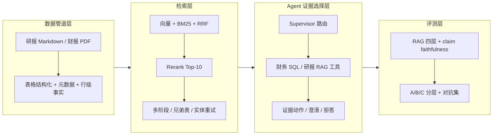

# 架构总览

> 本文件回答三件事：链路分几层、每层默认开还是关、每层能拿出哪个可核验数字。  
> 口径优先级：**代码默认值**用于判断“开箱即用能力”，**当前 `.env`** 只代表本机部署，**评测口径**不等于线上默认。

## 一、四层总览

图中实线是主链路；`多阶段 / 兄弟表 / 实体重试` 与 `证据动作` 目前是**实验路径，默认关闭**，详见各层状态。

## 二、数据管道层

**做什么**：研报 Markdown 与财报 PDF 入库；MinerU 解析；表格识别与结构化（`TableGrid` / `Table`）；元数据补全（`unit` / `report_period` / `table_type` / `table_scope` / `stock_code`）；chunk 切分；行级自包含事实与 `anchor_cells`；财报字段抽取入 MySQL。

**当前状态**：

| 能力 | 状态 | 说明 |
| --- | --- | --- |
| 研报 / 财报入库与切分 | **默认开（离线）** | `CHUNK_SIZE=1024`、`CHUNK_OVERLAP=100`、`CHUNK_MIN_CHARS=200` |
| 表格结构化解析 | **已实现，线上集合未切换** | `TABLE_CHUNK_MODE=legacy` 为代码默认；`research_reports_v3_structured` 为评测候选集合 |
| 行级事实 `row_fact` | **默认关** | `TABLE_ROW_FACT_MODE=off`；`research_reports_v6_rowfacts`（169,242 条）为阶段 2/3 评测索引 |
| `anchor_cells` | **默认写元数据，不影响检索** | 与 `TABLE_ROW_FACT_MODE=off` 配套 |

**核心量化（一个数）**：全库 **3,343/3,343 张表**原文 HTML 与解析结果的行数、列数、表头、关键单元格比对零差异。

**边界**：结构化索引与行级事实是评测口径，不是线上默认；线上默认仍是 `legacy` 切分。

## 三、检索层

**做什么**：Query 向量化；Qdrant 向量召回；BM25 关键词召回；RRF 融合；`qwen3-rerank` 精排到 Top-10；查询条件软过滤；表格行父表回拉；可选的多阶段检索（表级粗召回 → 行级精定位 → 整表返回）、兄弟表召回、实体定向重试。

**当前状态**：

| 能力 | 状态 | 说明 |
| --- | --- | --- |
| 混合检索（向量 + BM25 + RRF） | **默认开** | `HYBRID_ENABLED=true` |
| Rerank Top-10 | **默认开** | `RERANK_TOP_N=10`、`RERANK_OVERSAMPLE=2`、`RERANK_MAX_PER_FILE=2` |
| 查询缓存 | **默认开** | `QUERY_CACHE_ENABLED=true`，SQLite，TTL 86400s |
| 多阶段检索 | **默认关** | `MULTI_STAGE_RETRIEVAL_ENABLED=false`；仅在评测报告中使用 |
| 兄弟表召回 | **默认关** | `SIBLING_TABLE_RECALL_ENABLED=false`；仅 AEXP\|03/04 验证开启 |
| 实体硬闸门 / 行级证据闸门 | **默认关** | `ENTITY_GATE_ENABLED=false`、`ROW_GATE_ENABLED=false` |

**核心量化（一个数）**：默认混合检索路径下，数字级引用命中率 **70.6% → 74.9%**（旧 70.2% 为旧索引口径，已废弃）。

**评测口径备注**：多阶段检索在 27+4 道实体题上把 top-10 真内容从 **1.74 提到 2.33**、同主体从 **2.15 提到 2.78**；该结果依赖 `chunk_type=table` 过滤与行级索引，**未接入线上默认链路**。

## 四、Agent 证据选择层

**做什么**：LangGraph supervisor-workers 编排（规划 → 财务 SQL / 研报 RAG 子 Agent 并行 → 汇总）；Function Calling 双工具调用；子任务并行；按 `user_id` 持久化会话与多轮澄清；实验路径中的六类证据动作（`clarify_query` / `retry_table` / `route_to_sql` / `reject_with_reason` 等）与实体覆盖审计。

**当前状态**：

| 能力 | 状态 | 说明 |
| --- | --- | --- |
| LangGraph 多 Agent | **本机 `.env` 开；代码默认关** | `.env`：`AGENT_PLANNER_BACKEND=langgraph` + `AGENT_LANGGRAPH_MULTI_AGENT=true`；代码默认 `handwritten` + `false` |
| 子任务并行 | **默认开** | `AGENT_PARALLEL_TOOLS=true` |
| 多轮会话 | **默认关** | `ENABLE_MULTI_TURN=false`；API 侧按请求模式启用 |
| 六类证据动作 / 实体定向重试 | **默认关** | 依赖 `MULTI_STAGE_RETRIEVAL_ENABLED=true` 的实验运行时 |
| 财务 SQL 工具 | **默认可用** | MySQL 不可用时返回友好错误 JSON；SQL 三层防线（Schema / 静态校验 / 试运行） |

**核心量化（一个数）**：多 Agent 子任务并行后，端到端耗时 **107.9s → 78.9s（-27%）**。

**边界**：`accept` 不等于 `answer faithful`；检索接受只说明证据表被选中，不说明答案每个 claim 都被支持（B2005 支持率 16.7%、B2015 22.2%）。多 Agent 是当前部署选择，不是代码默认。

## 五、评测层

**做什么**：按 RAG 四层评测（L1 引用核验 / L2 答案质量 / L3 对抗挑战集 / L4 检索排序）+ Agent Tool 质量校验（SQL 编译 / 工具调用）；`python -m eval` 统一入口；golden 快照版本化；claim-level 数字 faithfulness；A/B/C 问题分层；人工标注与对抗集复核。

**当前状态**：

| 能力 | 状态 | 说明 |
| --- | --- | --- |
| `python -m eval` 统一入口 | **默认可用** | golden / sql / citation / report / llm-judge / challenge / consistency |
| L1 引用核验 | **已发布（确定性层）** | 引用文件可溯源 100%（1080/1080）；答案数字可溯源 99.9%（4068/4071） |
| L2 答案质量 | **未发布** | judge 与规则信号一致率 0.857（n=14），未做人工对齐 ≥0.90 |
| L3 对抗挑战集 | **已发布（挑战集口径）** | 18/18 人工复核通过；auto ↔ 人工一致率 100%（15/15） |
| L4 检索排序 | **未发布** | 仅 26 条可比子集：HR@10 0.3271 / nDCG@10 0.3014 / MRR 0.2565 |
| Agent Tool 质量校验（SQL 编译） | **已发布（确定性层）** | 95/95 语句通过；有 SQL 需求题 64/64；属于 Agent Tool 校验，不并入 RAG 四层 |
| A 类 claim faithfulness | **离线评测口径** | A 类 22 题中 20 道可评题 99.38%（95% CI 98.13–100）；不是线上默认指标 |

**核心量化（一个数）**：A 类 22 题中 20 道可评题的 claim faithfulness 为 **99.38%**（95% CI 98.13–100）。

**边界**：faithfulness 衡量“已生成的数字 claim 是否被返回证据支持”，不是答案准确率；AEXP|04 出现“拒答但引用他公司、faithfulness=1.0”，说明两者必须并列报告，不能混用。

## 六、默认开关总表

| 开关 | 代码默认 | 本机 `.env` | 影响 |
| --- | --- | --- | --- |
| `HYBRID_ENABLED` | `true` | 未覆盖 | 向量 + BM25 + RRF 混合检索 |
| `RERANK_TOP_N` | `10` | 未覆盖 | 精排后返回条数 |
| `QUERY_CACHE_ENABLED` | `true` | 未覆盖 | 查询结果缓存 |
| `AGENT_PARALLEL_TOOLS` | `true` | 未覆盖 | 子任务并行 |
| `ENABLE_MULTI_TURN` | `false` | 未覆盖 | 多轮会话默认关闭 |
| `AGENT_PLANNER_BACKEND` | `handwritten` | `langgraph` | Agent 编排后端 |
| `AGENT_LANGGRAPH_MULTI_AGENT` | `false` | `true` | supervisor-workers 多 Agent |
| `MULTI_STAGE_RETRIEVAL_ENABLED` | `false` | 未覆盖 | 多阶段检索 |
| `SIBLING_TABLE_RECALL_ENABLED` | `false` | 未覆盖 | 同文档兄弟表召回 |
| `ENTITY_GATE_ENABLED` | `false` | 未覆盖 | 实体硬过滤 |
| `ROW_GATE_ENABLED` | `false` | 未覆盖 | 行级证据闸门 |
| `TABLE_CHUNK_MODE` | `legacy` | 未覆盖 | 表格切分口径 |
| `TABLE_ROW_FACT_MODE` | `off` | 未覆盖 | 行级事实子块 |
| `OBSERVABILITY_LOG_ENABLED` | `true` | 未覆盖 | 每请求 JSONL 结构化日志 |
| `LLM_STREAM_INCLUDE_USAGE` | `true` | 未覆盖 | 流式调用请求 usage |
| `API_AUTH_ENABLED` | 自动（`API_KEYS` 非空则开） | 未覆盖 | API key 鉴权 |
| `API_RATE_LIMIT_PER_MINUTE` | `10` | 未覆盖 | 每 key 每分钟限流 |
| `LLM_INPUT_PRICE_PER_1K` / `LLM_OUTPUT_PRICE_PER_1K` | 未登记 | 未覆盖 | 成本估算；未登记时写 `unit_price_not_registered` |

## 七、口径提醒

1. **主口径**：A 类 12 题 **90.62%**、A 类 22 题中 20 道可评题 **99.38%**（95% CI 98.13–100）、22 题端到端 **90.34%**（95% CI 76.70–100）。
2. **内部候选**：v2 12 题 **98.61%**、22 题端到端 **94.70%**、21 题可评题 **99.21%**；依赖多阶段 + 实体定向重试，未接线上默认。
3. **不再引用**：**99.65%** 依赖 `coarse_k=400` 全局扩召回，检索段 P95 从 876ms 升到 3,307ms，后续未稳定复现。
4. **108 题全量 44.05% 是混合口径**：A 类 12 / B 类 75 / C 类 21，不能直接对标企业 0.80+。
5. **A 类 22 题不是真实用户分布**：其中 10 题从 `anchor_cells` 高置信行反向生成，金标可能因多篇研报预测不同而不唯一。
6. **未测**：MinerU 文件级解析成功率、独立 Rerank 单次延迟、端到端 P99、300 条完整 RAG-L4 指标。
7. **2026-10-23 夜间补充**：结构化日志、API 鉴权/限流已实现并有单测；10 题日志实测已完成（P95 总延迟 59.1s、生成占 90.6%、304,960 tokens；成本单价未登记）；Memory R@5 已完成（10 条追问，0%→30%，+30pp）；单/多 Agent 对照、Locust 50 并发仍 `[SKIP]`，原因见 `README.md#已知边界`。

## 八、服务化与可观测性（2026-10-23）

| 能力 | 状态 | 说明 |
| --- | --- | --- |
| 结构化请求日志 | **已实现，默认开** | 每请求 `trace_id` / 检索 / 精排 / 生成 / 总耗时 / token / 模型 / 成本状态；写入 `训练结果数据/logs/YYYYMMDD.jsonl` |
| 日志聚合 | **已实现** | `eval/log_aggregate.py` 输出 P50/P95/P99、Token、成本状态、阶段占比；缺失值保持 `null` |
| 10 题 A 类日志实测 | **已完成（10 题，单机顺序）** | P95 总延迟 **59.1s**；检索/精排/生成 P95 为 3.73s / 0.84s / 40.0s；生成占 90.6%；总 token **304,960**；成本 `unit_price_not_registered` |
| Token 成本 | **口径已就绪，单价未登记** | 未配置单价时 `cost_status=unit_price_not_registered`，不编造金额 |
| API key 鉴权 | **已实现** | 配置 `API_KEYS` 后无 key 401、错误 key 403、正确 key 放行；`/health` 等免鉴权 |
| API 限流 | **已实现，单进程内存** | 每 key 10 req/min 滑动窗口；多 worker 需 Redis/网关级限流 |
| API 安全单测 | **通过** | `tests/test_api_security.py` + `tests/test_api_contracts.py`：30 passed |
| Memory R@5 | **已完成（10 条追问）** | 无记忆 0/10、有记忆 3/10（30%，+30pp）；严格同条证据口径；6 题实体/指标未进 top-5、1 题字段分散 |
| 单/多 Agent 对照 | **[SKIP]** | 环境不可用 + A 类成功判据未冻结；历史并行延迟收益不等于成功率 |
| Locust 50 并发 | **脚本已实现，实测 [SKIP]** | `locust` 未安装、API 不可用；无 P50/P95/P99 |

## 九、相关文档

- `docs/ARCHITECTURE.md`：架构与现状差距清单
- `docs/技术选型对比.md`：RRF / Cross-Encoder / 整表向量 / 多阶段等选型依据
- `docs/评估报告/README.md`：评估报告索引与口径
- `docs/问题记录/badcase_台账.md`：缺陷台账与修复闭环
- `README.md#已知边界`：默认关闭能力、未测数字与内部候选口径
